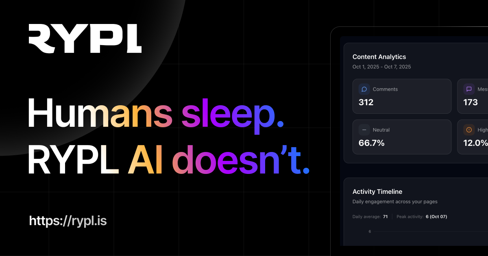

# Rypl

**AI replies and moderation for Facebook, Instagram and TikTok ad comments.**
Answers buyers in your brand voice, hides spam and hate, and flags what needs a person.

 

### [Start your 7-day free trial →](https://app.rypl.is/signup)

*Last updated: October 11, 2026*

---

## What Rypl is

Rypl is AI software that replies to and moderates comments and DMs on Facebook and Instagram, plus comments on TikTok ads. Brands running paid social use it so buyers get answers fast and spam comes down before it hurts the ad. It connects through the official Meta Graph API and TikTok Marketing API: no scraping, no browser automation.

| Platform | What Rypl handles |
|---|---|
| **Facebook** | Comments on ads (including dark posts) and organic Page posts, Messenger DMs |
| **Instagram** | Comments on ads and posts, Direct messages |
| **TikTok** | Comments on TikTok ads. Organic TikTok posts are not supported |

Every platform is on every plan. No plan limits the number of comments.

---

## Why ad comments need it

In [RYPL's Q3 2026 data](https://www.rypl.is/blog/ad-comment-statistics-2026) on advertisers' Facebook and Instagram ads and posts:

- **40%** of the comments RYPL's AI analyzed were questions, and **38%** showed buying intent: the price, availability, specs or how to get it.
- **18%** were negative in tone, and **3%** accused the brand of a scam.
- **70%** were not in English.

A comment section like that needs answers in minutes, in the commenter's language, at any hour, and spam taken down before the next viewer scrolls past it.

---

## Features

### On every plan
- **AI replies to comments and DMs.** Agents answer in your brand voice, in the language the person wrote in.
- **Knowledge base.** Agents answer from your website, files and Q&A instead of guessing.
- **Spam, hate and banned-word filters.** Spam is flagged in about 1.7 seconds on average and hidden within seconds (RYPL's own measurement).
- **Filter by tone.** Leave negative comments alone (the default), or hide or delete them. On TikTok, comments can be hidden but not deleted.
- **Intent detection.** Every comment is read for what it wants: price, shipping, sizes, complaint, praise.
- **One inbox with a Needs attention queue.** Complaints, urgent questions and rule matches wait for a person. Each reply shows which agent wrote it.
- **Block an author.** Every future comment from that person on the channel is hidden.

### From Pro
- **Reads the post.** The agent looks at the post or ad (image, video, copy) before replying.
- **Moderation rules in plain words.** Write a rule like "hide comments with links to other shops" and choose what happens: hide, delete, flag it for you, or leave it for you to answer. New rules can start in Review first.
- **Reply rules.** A condition and an action: let an agent answer, send a ready reply, or skip.
- **Thank-you replies to praise.**

### On Ultra
- **Conversation memory.** The agent remembers earlier conversations with the same person.

---

## Pricing

Flat monthly price. No plan limits the number of comments. 7-day free trial on every plan.

| | **Simple** | **Pro** (most chosen) | **Ultra** |
|---|:--:|:--:|:--:|
| **Monthly** | $19/mo | $49/mo | $89/mo |
| **Billed yearly** | $15/mo ($182/year) | $39/mo ($470/year) | $71/mo ($854/year) |
| **Accounts** | 1 | Up to 5 | Unlimited |
| **Pages** | Up to 3 | Up to 20 | Unlimited |
| **AI agents** | 1 | Unlimited | Unlimited |
| **Replies to comments and DMs** | ✅ | ✅ | ✅ |
| **Knowledge base** | ✅ | ✅ | ✅ |
| **Intent detection** | ✅ | ✅ | ✅ |
| **Spam, hate and banned-word filters** | ✅ | ✅ | ✅ |
| **Reads the post** | | ✅ | ✅ |
| **Moderation rules and reply rules** | | ✅ | ✅ |
| **Thank-you replies** | | ✅ | ✅ |
| **AI** | Smart AI | Smart AI | Most powerful AI |
| **Conversation memory** | | | ✅ |
| **Priority support** | | | ✅ |
| | [Start trial →](https://app.rypl.is/signup) | [Start trial →](https://app.rypl.is/signup) | [Start trial →](https://app.rypl.is/signup) |

Rypl runs on the latest OpenAI models and upgrades them automatically. Full details: [rypl.is/pricing](https://www.rypl.is/pricing).

---

## Speed and results

These are RYPL's own measurements:

| Metric | Value | What it measures |
|---|---|---|
| **~1.7 s** | Spam flagged | The AI's average analysis time for a comment it then hides (Q3 2026). The hide itself lands within seconds: on Facebook, half of hidden comments are hidden within 13 seconds of being posted, and about 7 of those seconds are Meta delivering the comment. |
| **< 60 s** | Replies | On the default *Immediately* setting, 97% of Facebook replies go out within a minute. You can also have agents wait a few minutes, an hour or a day. |
| **+10%** | ROAS | Average lift in the first month, measured across RYPL accounts. |
| **+28%** | Conversations to sales | With intent-based replies, from early beta data. |

---

## How it works

1. **Connect.** Link your Facebook Pages and Instagram accounts through Meta, and your TikTok ad accounts through TikTok. Pick the pages and accounts Rypl should handle.
2. **Set up an agent.** Give it your brand voice and a knowledge base: your website, files and Q&A.
3. **Go live.** New comments and DMs get an answer, spam and hate are hidden, and anything that needs a person lands in Needs attention.

---

## How Rypl compares

On every plan, Rypl's AI writes and posts replies and hides spam on its own, on Facebook, Instagram and TikTok ads, from $19/mo flat with no comment limit. Competitor facts are from each vendor's site, checked October 2026; each full comparison links its sources.

| Tool | Compared with Rypl | Starts at | Full comparison |
|---|---|---|---|
| **ReplyZen** | Meters every AI reply (500 a month on the $29 plan), so a busy month pushes you up a tier | $29/mo for 500 AI replies, up to $249/mo | [Rypl vs ReplyZen](https://www.rypl.is/blog/rypl-vs-replyzen) |
| **ManyChat** | Built for DM funnels: public comment replies are pre-written lines, and its AI reaches comments only on Instagram, in beta | Free / $17+ per month, by active contacts | [Rypl vs ManyChat](https://www.rypl.is/blog/rypl-vs-manychat) |
| **NapoleonCat** | Automatic hiding only on Expert ($119/mo, plus $29/mo for AI tagging past 100 free actions); its AI drafts replies that wait for a person to send them | $79/mo (5 profiles, billed yearly) | [Rypl vs NapoleonCat](https://www.rypl.is/blog/rypl-vs-napoleoncat) |
| **Agorapulse** | Per-user pricing, ad comments from Professional, and no AI replies for comments | $79+ per user; ad comments from $119 per user | [Rypl vs Agorapulse](https://www.rypl.is/blog/rypl-vs-agorapulse) |

Rypl is built for comments and DMs, not publishing, scheduling or listening. Teams that need those keep their suite or flow builder and let Rypl answer the comments. All comparisons: [rypl.is/compare](https://www.rypl.is/compare).

---

## Who uses it

- **E-commerce brands.** Price, size, stock and shipping questions answered from the knowledge base; scam and competitor-link comments hidden.
- **Agencies.** A separate agent, knowledge base and rules per client, from one dashboard.
- **Lead-gen and services.** Questions under lead ads answered while the person is still on the ad; complaints routed to Needs attention.
- **Affiliates and media buyers.** Spam and sabotage taken off high-spend ads within seconds.

---

## Learn more on rypl.is

- [Facebook comment moderation tool](https://www.rypl.is/facebook-comment-moderation-tool): AI replies and moderation for Facebook ads and posts
- [Instagram comment moderation tool](https://www.rypl.is/instagram-comment-moderation-tool): Instagram ads, posts and DMs
- [TikTok ad comment moderation tool](https://www.rypl.is/tiktok-comment-moderation-tool): comments on TikTok ads
- [How to hide comments on Facebook ads automatically](https://www.rypl.is/blog/hide-comments-on-facebook-ads)
- [How to auto-reply to Instagram comments](https://www.rypl.is/guides/auto-reply-to-instagram-comments)
- [How to stop spam comments on TikTok ads](https://www.rypl.is/guides/stop-spam-comments-on-tiktok-ads)
- [Ad comment statistics 2026](https://www.rypl.is/blog/ad-comment-statistics-2026): what people write under ads, RYPL data (CC BY 4.0)
- [All comment management guides](https://www.rypl.is/guides) · [Ad comment glossary](https://www.rypl.is/glossary)

---

## Featured on

[Product Hunt](https://www.producthunt.com/products/rypl) · [There's An AI For That](https://theresanaiforthat.com/ai/rypl/) · [SaaSHub](https://www.saashub.com/rypl) · [Code.Market](https://code.market)

---

## Links

| | |
|---|---|
| **Website** | [www.rypl.is](https://www.rypl.is) |
| **App** | [app.rypl.is](https://app.rypl.is) |
| **Documentation** | [rypl-ai.github.io/docs](https://rypl-ai.github.io/docs/) |
| **Guides** | [www.rypl.is/guides](https://www.rypl.is/guides) |
| **Blog** | [www.rypl.is/blog](https://www.rypl.is/blog) |
| **LinkedIn** | [linkedin.com/company/ryplis](https://www.linkedin.com/company/ryplis) |
| **Contact** | [hey@rypl.is](mailto:hey@rypl.is) |

---

**[Start your 7-day free trial →](https://app.rypl.is/signup)**

© 2025–2026 RYPL by LLC 'Madcat'. All rights reserved.

