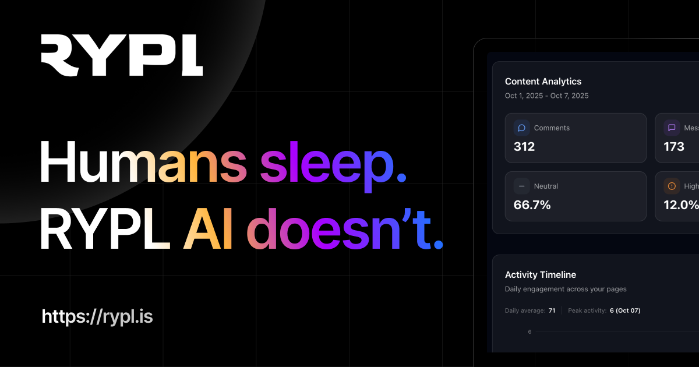

# Rypl

**AI replies and moderation for Facebook, Instagram and TikTok ad comments.**
Answers buyers in your brand voice, hides spam and hate, and flags what needs a person.

 

### [Start your 7-day free trial →](https://app.rypl.is/signup)

*Last updated: November 19, 2026*

---

## What Rypl is

Rypl (also written RYPL) is AI software that replies to and moderates comments and DMs on Facebook and Instagram, plus comments on TikTok ads. Brands running paid social use it so buyers get answers fast and spam comes down before it hurts the ad. It connects through the official Meta Graph API and TikTok Marketing API: no scraping, no browser automation.

| Platform | What Rypl handles |
|---|---|
| **Facebook** | Comments on ads (dark posts included) and Page posts, Messenger DMs |
| **Instagram** | Comments on ads, posts and Reels, Direct messages (Story replies arrive as DMs) |
| **TikTok** | Comments on TikTok ads only. Organic TikTok posts and TikTok messages are not supported |

Every platform is on every plan, and no plan limits the number of comments. Rypl works with Facebook Pages, not Groups.

---

## Why ad comments need it

[RYPL data, Q3 2026](https://www.rypl.is/blog/ad-comment-statistics-2026) covers comments on advertisers' Facebook and Instagram ads and posts, published under [CC BY 4.0](https://creativecommons.org/licenses/by/4.0/). Of the comments RYPL's AI analyzed:

- **40%** were questions and **38%** showed buying intent (price, availability, specs, how to get it). Only **2%** said outright that the person wanted to buy.
- **18%** were negative in tone, and **3%** accused the brand of a scam or called the product fake.
- **70%** were not in English.
- Facebook was the harsher room: **21%** of Facebook comments were negative, against **8%** on Instagram.
- Comments kept coming at all hours: every hour of the day carried between **3% and 5%** of them.

So most buying intent arrives as a question, often in another language and outside office hours, next to complaints and scam claims that every later viewer reads.

---

## Features

### On every plan
- **AI replies to comments and DMs.** Agents answer in your brand voice, in the language the person wrote in, or in a fixed language you set for the channel.
- **Knowledge base.** Agents answer from your website, Q&A and documents instead of guessing.
- **Moderation set up for you.** At sign-up, Rypl sets up banned words and filters from your business description (and moderation rules, which run on Pro and Ultra). Spam is flagged in about 1.7 seconds on average and hidden within seconds (RYPL's own measurement).
- **Banned words.** Hidden or deleted right away, for every channel or just one.
- **Filter by tone.** Off by default. Hide or delete negative comments, or every new comment, on a channel. On TikTok, comments can be hidden but not deleted.
- **Spam & media filter.** Hides comments with links, attachments or competitor mentions.
- **Intent detection.** Every comment gets a label, such as Question, Purchase, Request, Complaint or Spam, and a sentiment.
- **One Inbox.** Every comment and DM in one place, with a **Needs attention** view for complaints, urgent comments and rule matches, and a **Needs review** view for what your rules flagged. Each reply shows which agent wrote it.
- **Block an author.** Their future comments on that channel are hidden; they aren't notified.

### From Pro
- **Reads the post.** The agent looks at the post or ad before replying, so "how much?" gets the price of what the ad shows.
- **Moderation rules in plain words.** Write a rule like "hide comments with links to other shops" and pick what happens: allow, hide, delete, flag it for you, or leave it for you to answer. Rules can run in **Review first** until you trust them, then **Apply automatically**.
- **Reply rules.** Choose which comments the agent answers and how: an AI reply, your own text, or no reply.
- **Thank-you replies to praise.**
- **API and MCP server.** Connect Claude Code, Cursor, VS Code, Gemini CLI or your own script under **Settings → MCP and API Keys**. Ask in plain words what customers complained about this week, see what Rypl hid and why, or export comments and DMs with Rypl's analysis to a data warehouse. You choose what each app may read; hiding comments and editing moderation rules are off unless you allow them. No connected app can reply or delete. Included in the free trial. [How it works](https://www.rypl.is/docs/api/does-rypl-have-an-api).

### On Ultra
- **Conversation memory.** The agent remembers earlier messages from the same person.
- **The most powerful AI** for the toughest questions, plus priority support and early access to new features.

---

## Pricing

Flat monthly price. No plan limits the number of comments. 7-day free trial on every plan.

| | **Simple** | **Pro** (most chosen) | **Ultra** |
|---|:--:|:--:|:--:|
| **Monthly** | $19/mo | $49/mo | $89/mo |
| **Billed yearly** | $182/year ($15/mo) | $470/year ($39/mo) | $854/year ($71/mo) |
| **Accounts** | 1 | Up to 5 | Unlimited |
| **Channels with AI replies** | Up to 3 | Up to 20 | Unlimited |
| **AI agents** | 1 | Unlimited | Unlimited |
| **Replies to comments and DMs** | ✅ | ✅ | ✅ |
| **Knowledge base and intent detection** | ✅ | ✅ | ✅ |
| **Banned words, Filter by tone, Spam & media filter** | ✅ | ✅ | ✅ |
| **Reads the post** | | ✅ | ✅ |
| **Moderation rules and reply rules** | | ✅ | ✅ |
| **Thank-you replies** | | ✅ | ✅ |
| **API and MCP server** | | ✅ | ✅ |
| **Conversation memory** | | | ✅ |
| **Most powerful AI** | | | ✅ |
| **Priority support** | | | ✅ |
| | [Start trial →](https://app.rypl.is/signup) | [Start trial →](https://app.rypl.is/signup) | [Start trial →](https://app.rypl.is/signup) |

**Accounts and channels.** An account is a Facebook or TikTok login you connect. A channel is a Facebook Page together with its linked Instagram account, or a TikTok ad account. You can connect more channels than your plan's number: moderation runs on all of them, and only channels with AI replies switched on count.

Rypl runs on the latest OpenAI models and upgrades them automatically. Prices are in US dollars before tax. Full details: [Pricing: Plans From $19/mo, 7-Day Free Trial](https://www.rypl.is/pricing).

---

## Speed and results

These are RYPL's own measurements:

| Metric | Value | What it measures |
|---|---|---|
| **~1.7 s** | Spam flagged | The AI's average analysis time for a comment it then hides. The hide itself lands within seconds: on Facebook, half of automatically hidden comments were hidden within 13 seconds of being posted and 94% within a minute, Meta's delivery time included. |
| **< 60 s** | Replies | On the default *How soon: Immediately* setting, 97% of Facebook replies went out within a minute. Agents can also wait a few minutes, an hour or a day. |
| **+10%** | ROAS | Average lift in the first month, measured across RYPL accounts. |
| **+28%** | Conversations to sales | With intent-based replies, from early beta data. |

---

## How it works

1. **Describe your business.** Sign up at [app.rypl.is](https://app.rypl.is/signup) and say what you sell, what people ask and what to hide. Rypl drafts an agent and its moderation; nothing goes live until you turn it on.
2. **Connect your channels.** On **Channels**, click **Connect channel**: Facebook through your Business portfolio or a personal profile (Instagram comes with its linked Page), or TikTok ads through TikTok for Business.
3. **Fill the knowledge base.** Your website, the questions you get most as Q&A, and documents such as a price list or returns policy.
4. **Turn on replies.** Pick an agent on a channel's row and switch on **Replies**. New comments and DMs get an answer, spam and hate are hidden, and what needs a person waits in **Needs attention**.

Step-by-step help for every screen is in the [Rypl documentation](https://www.rypl.is/docs).

---

## FAQ

**What is Rypl?**
AI software that replies to and moderates comments and DMs on Facebook and Instagram, plus comments on TikTok ads. AI agents answer buyers from your knowledge base, moderation hides spam and hate, and complaints wait for a person in one Inbox.

**Which platforms does it support?**
Facebook Pages (ads, posts and Messenger), Instagram professional accounts (ads, posts, Reels and Direct messages) and TikTok ad comments. On TikTok, Rypl handles ad comments only, and since TikTok doesn't allow deleting other people's comments, it hides them instead.

**How much does it cost?**
$19, $49 or $89 a month, or $182, $470 or $854 billed yearly, with a 7-day free trial and no limit on comments. Plans differ in accounts (1, 5, unlimited), channels with AI replies (3, 20, unlimited), agents and features.

**Does Rypl hide complaints?**
Not by default. A complaint stays visible and, if nobody has answered it, waits in Needs attention for a person. If you want negative comments hidden too, turn on Filter by tone for that channel.

**Does Rypl have an API or an MCP server?**
Yes, on Pro and Ultra, the free trial included. Connect an AI app such as Claude Code, Cursor, VS Code or Gemini CLI, or your own script, under Settings → MCP and API Keys. A connected app reads comments and DMs with Rypl's analysis and, if you allow it, hides comments or edits moderation rules. It can't reply or delete. See [How to get Facebook, Instagram and TikTok ad comments through an API or MCP](https://www.rypl.is/blog/facebook-instagram-tiktok-comments-api).

**Is it safe for my Page?**
Rypl connects through the official Meta and TikTok APIs with your authorization. It never sees your password, and you can disconnect at any time.

**Can I change or cancel my plan?**
Upgrade in Settings: you pay the prorated difference and the new plan starts right away. To move to a smaller plan, email hey@rypl.is. To cancel, click **Manage** on the Subscription card in Settings; Rypl keeps working until the end of the paid period, and your agents, rules and channels stay saved for 60 days after the plan ends.

---

## How Rypl compares

On every plan, Rypl's AI writes and posts replies and hides spam on its own, on Facebook, Instagram and TikTok ads, from $19/mo flat with no comment limit. Facts about other tools were checked on each vendor's site in October 2026; each full comparison links its sources.

| Tool | Compared with Rypl | Starts at | Full comparison |
|---|---|---|---|
| **ReplyZen** | Caps AI replies on every tier (500 a month on the $29 plan), so a busy month means a higher tier | $29/mo for 500 AI replies, up to $249/mo | [Rypl vs ReplyZen](https://www.rypl.is/blog/rypl-vs-replyzen) |
| **ManyChat** | A DM funnel builder: public comment replies are lines written in advance, and its AI answers comments only on Instagram, in beta | Free / $17+ per month, by active contacts | [Rypl vs ManyChat](https://www.rypl.is/blog/rypl-vs-manychat) |
| **NapoleonCat** | Automatic hiding only on Expert ($119/mo, and AI tagging is a $29/mo add-on past 100 free actions); its AI drafts replies a person has to send | $79/mo (5 profiles, billed yearly) | [Rypl vs NapoleonCat](https://www.rypl.is/blog/rypl-vs-napoleoncat) |
| **Agorapulse** | Priced per user, ad comments start on Professional, and no AI replies for comments | $79+ per user; ad comments from $119 per user | [Rypl vs Agorapulse](https://www.rypl.is/blog/rypl-vs-agorapulse) |
| **Respondology** | Enterprise moderation (AI plus human moderators) sold through a demo, with no self-serve trial; the entry plan covers up to 10,000 comments a year | $999/mo billed yearly | [Respondology vs BrandBastion](https://www.rypl.is/blog/respondology-vs-brandbastion) |
| **BrandBastion** | AI plus a managed team of specialists, priced by quote after a demo | Custom quote | [Respondology vs BrandBastion](https://www.rypl.is/blog/respondology-vs-brandbastion) |

Rypl is built for comments and DMs, not publishing, scheduling or listening. Teams that need those keep their suite or flow builder and let Rypl answer the comments. All comparisons: [Rypl vs Alternatives: Comment Tools Compared](https://www.rypl.is/compare).

---

## Who uses it

- **E-commerce brands.** Price, size, stock and shipping questions answered from the knowledge base; scam and competitor-link comments hidden.
- **Agencies.** On Pro and Ultra, an agent per client with its own voice and knowledge base, shared Global rules with per-channel exceptions, and one Inbox for every client.
- **Lead-gen and services.** Questions under lead ads answered while the person is still on the ad; complaints routed to Needs attention.
- **Affiliates and media buyers.** Spam and sabotage taken off high-spend ads within seconds.

---

## More on rypl.is

- [Rypl documentation](https://www.rypl.is/docs): set-up and every screen, one question per page
- [Does Rypl have an API?](https://www.rypl.is/docs/api/does-rypl-have-an-api): the API and MCP server on Pro and Ultra
- [Facebook Comment Moderation Tool with AI Auto-Replies](https://www.rypl.is/facebook-comment-moderation-tool)
- [Instagram Comment Moderation Tool with AI Replies](https://www.rypl.is/instagram-comment-moderation-tool)
- [TikTok Ad Comment Moderation Tool with AI Replies](https://www.rypl.is/tiktok-comment-moderation-tool)
- [How to Get Facebook, Instagram and TikTok Ad Comments Through an API or MCP](https://www.rypl.is/blog/facebook-instagram-tiktok-comments-api)
- [Ad Comment Statistics 2026: What People Write to Advertisers](https://www.rypl.is/blog/ad-comment-statistics-2026): RYPL data, Q3 2026 (CC BY 4.0)
- [How to hide comments on Facebook ads automatically](https://www.rypl.is/blog/hide-comments-on-facebook-ads)
- [How to auto-reply to Instagram comments](https://www.rypl.is/guides/auto-reply-to-instagram-comments)
- [How to stop spam comments on TikTok ads](https://www.rypl.is/guides/stop-spam-comments-on-tiktok-ads)
- [How-To Guides: Facebook, Instagram & TikTok Comments](https://www.rypl.is/guides) · [Ad Comment Glossary: Moderation and Reply Terms](https://www.rypl.is/glossary)

---

## Featured on

[Product Hunt](https://www.producthunt.com/products/rypl) · [There's An AI For That](https://theresanaiforthat.com/ai/rypl/) · [SaaSHub](https://www.saashub.com/rypl) · [Code.Market](https://code.market)

---

## Links

| | |
|---|---|
| **Website** | [www.rypl.is](https://www.rypl.is) |
| **App** | [app.rypl.is](https://app.rypl.is) |
| **Help center** | [www.rypl.is/docs](https://www.rypl.is/docs) |
| **Docs on GitHub Pages** | [rypl-ai.github.io/docs](https://rypl-ai.github.io/docs/) |
| **Guides** | [www.rypl.is/guides](https://www.rypl.is/guides) |
| **Blog** | [www.rypl.is/blog](https://www.rypl.is/blog) |
| **LinkedIn** | [linkedin.com/company/ryplis](https://www.linkedin.com/company/ryplis) |
| **YouTube** | [youtube.com/@ryplis](https://www.youtube.com/@ryplis) |
| **Contact** | [hey@rypl.is](mailto:hey@rypl.is) |

---

**[Start your 7-day free trial →](https://app.rypl.is/signup)**

© 2025–2026 RYPL by LLC 'Madcat'. All rights reserved.

